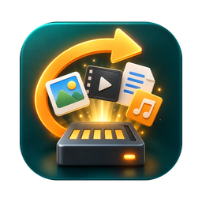
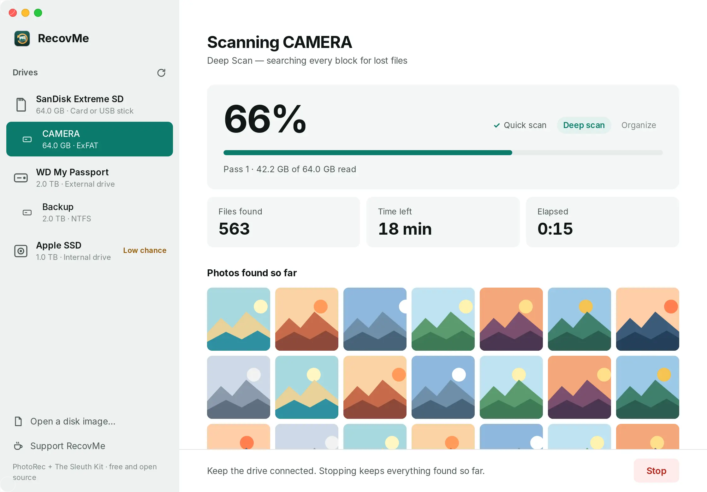

<p align="center">
  
</p>

<h1 align="center">RecovMe</h1>

<p align="center">
  <b>Free, open-source file and photo recovery for Mac and Windows. No paywall after the scan.</b>
</p>

<p align="center">
  <a href="https://github.com/trevnedai/recovme/releases/latest"></a>
  
  
  <a href="LICENSE"></a>
</p>

<p align="center">
  <a href="https://recovme.app"><b>Website</b></a> ·
  <a href="https://github.com/trevnedai/recovme/releases/latest"><b>Download</b></a> ·
  <a href="https://recovme.app/guides/"><b>Guides</b></a> ·
  <a href="https://recovme.app/it/guide/">Guide in italiano</a>
</p>

<p align="center">
  
</p>

Bring back deleted and formatted photos, videos, music, recordings, CCTV and dashcam footage
and documents from SD cards, USB sticks, external drives and hard disks, and copy what still
survives on Android phones and in iPhone or iPad backups. Free, open source,
private (nothing leaves your computer) and **read-only** on the drive you scan.

Runs on **macOS 11 or later (Apple silicon)** and **Windows 10/11 (64-bit)**.

## Why RecovMe

Many "free" recovery apps scan for free, show you your lost files, then ask you to pay before
you can save them. RecovMe doesn't.

| | Typical "free" recovery app | RecovMe |
|---|---|---|
| Saving the files it finds | Pay first (license or subscription) | Free, always |
| How much you can recover | A free limit of a few hundred MB to 2 GB | No limit |
| Account or sign-up | Often required | None |
| Your files | Varies; many collect usage data | Never leave your computer |
| Source code | Closed | Open (GPL-3.0) |

If RecovMe brought your files back, the best thanks is a ⭐ on this repo, or telling someone
who just lost theirs. Donations are optional: [recovme.app/#coffee](https://recovme.app/#coffee).

## How it works

RecovMe runs two proven recovery engines and tidies up what they find:

| Step | Engine | What it does |
|---|---|---|
| **Quick Scan** | [The Sleuth Kit](https://sleuthkit.org) `tsk_recover` | Reads the drive's file table and brings back recently deleted files **with their original names and folders**. Works on FAT, exFAT and NTFS drives (SD cards, USB sticks, Windows drives). |
| **Deep Scan** | [PhotoRec](https://www.cgsecurity.org/wiki/PhotoRec) | Searches every block for file signatures — **480+ file types** — even after a format or when the file table is gone. |
| **Organize** | RecovMe | Sorts results into `Photos / Videos / Audio / Documents / Archives / Other`, names photos by the date they were taken (`Photos/2024-07/2024-07-12 14.33.02.jpg`), removes duplicates (size first, then BLAKE3 only when sizes match), drops empty files and sets tiny embedded thumbnails aside. |

**Smart scan** (the default) runs Quick Scan first, then Deep Scan, and removes Deep Scan
copies of files Quick Scan already found by name.

### Phones and tablets

Phones can't be searched block by block like a memory card: iPhones never allow it, and
Android phones encrypt their storage and erase deleted space. So RecovMe copies the places
where deleted files really survive, and lists them under **Phones & Tablets**:

| Device | How | What it brings back |
|---|---|---|
| **Android** | USB debugging, through Google's `adb` (bundled) | The system trash (Android 11+ keeps deleted photos and videos 30 days as hidden `.trashed-…` files; names are restored) and unfinished `.pending-…` files, gallery and file manager trash (Samsung Gallery and My Files, restored to their original folder; Xiaomi, Huawei, OPPO, OnePlus, vivo, Files by Google), Telegram's cache of viewed media, WhatsApp (statuses included), Telegram, Viber and other chat media, thumbnail caches (mostly useful before Android 10, which deletes thumbnails with the photo). Optionally a copy of everything in the phone's own folders. Files with no extension are identified by their content. |
| **iPhone / iPad** | The backups Finder, iTunes or Apple Devices made on this computer, found automatically (or open one from another drive with *Open a Disk Image or Backup…*) | Camera Roll with original names (Recently Deleted and the Hidden album in their own folders, read from the Photos library), previews of iCloud-only photos, messages in Messages → Recently Deleted (iOS 16+) as a text file with their photos, Messages and WhatsApp attachments, voice memos with their titles, Notes, Files and app documents. **Encrypted backups** are opened with their password, which is never saved. |

**What it can't do:** bring back files that are fully deleted from a phone. Nothing can:
the data no longer exists on the phone. The app says so before the first phone scan.

Memory cards from cameras, drones, dashcams and consoles are drives: put them in a card
reader. If an Android phone has a memory card, scanning the card in a reader finds more.

### Speed
- Deep Scan searches the **whole drive** by default, so it finds the most even after a format, and leaves out files that are still on the drive. Turn off *Search the whole drive* for a faster search of free space only.
- Only the file types you choose are searched for — fewer signatures, faster scan.
- macOS reads the raw device (`/dev/rdiskN`), which is much faster than the buffered one.
- Live progress, time left and a preview of photos found; **Stop** keeps everything found so far.

### Safety
- Engines only **read** the source drive. Results must be saved to a **different drive** — the app refuses otherwise.
- On macOS the drive is unmounted during the scan (optional, on by default) so the system can't write to it.

### Honest limits
- **Internal SSDs** (and every Apple Silicon Mac's internal drive) erase deleted data automatically (TRIM) and are encrypted, so carving rarely finds anything. Check Trash, Time Machine / File History and cloud backups first. The app warns about this.
- Files that were partly overwritten come back damaged. Open the important ones and back them up.

## Using it

1. Pick the drive (or a volume on it, or a disk image file).
2. Choose what to look for and the scan type.
3. Choose where to save (another drive), then **Start scan**.

- **macOS:** enter your password when asked — the engines need it to read the drive. If a scan says it can't read the drive, allow RecovMe in *System Settings → Privacy & Security → Full Disk Access*.
- **Windows:** the app asks for administrator rights when it opens (needed for raw disk access).
- **Android:** turn on *USB debugging* (Settings → About phone → tap *Build number* 7 times →
  Developer options), connect the phone, and tap *Allow* on the phone. The app's
  *Phone Not Listed?* link shows the steps.
- **iPhone / iPad:** scan an existing backup *before* making a new one, since a new backup
  replaces the old one. On macOS, reading backups needs *Full Disk Access* for RecovMe.

## Building

The engines are built/fetched by scripts, then bundled into the app:

```bash
# macOS (Apple Silicon, needs Xcode command line tools + Homebrew)
bash scripts/build-engines-macos.sh
npm ci
npx tauri build --bundles app,dmg
```

```powershell
# Windows (PowerShell 7)
./scripts/fetch-engines-windows.ps1
npm ci
npx tauri build --bundles nsis
```

Or push to GitHub and run **Actions → Build installers → Run workflow**: it produces a
`.dmg` and a Windows installer. Pushing a tag like `v0.1.0` also publishes a GitHub Release.

### Automatic updates

From 0.3.0 the app updates itself (Tauri's updater). At start it fetches
`https://github.com/trevnedai/recovme/releases/latest/download/latest.json`; when that names a
newer version, **Update and Restart** downloads the Mac `.app.tar.gz` or the Windows installer,
checks its signature against the public key in `src-tauri/tauri.conf.json`, installs it and
restarts. Users can turn the check off; it never sends anything about their files.

The release job signs the update files and writes `latest.json` once these repository secrets exist:

| Secret | What it is |
|---|---|
| `TAURI_SIGNING_PRIVATE_KEY` | The private update key (text from `npx tauri signer generate`) |
| `TAURI_SIGNING_PRIVATE_KEY_PASSWORD` | Its password |

**Keep a backup of this key.** Without it, no installed copy can be updated again: they only
accept updates signed with the matching key. Without the secrets, releases are published as
before and installed apps simply see no update.

### Signing and notarizing the Mac app

The macOS build signs and notarizes the app by itself once these repository secrets
exist (Settings → Secrets and variables → Actions). Without them it builds unsigned.

| Secret | What it is |
|---|---|
| `APPLE_CERTIFICATE` | Your **Developer ID Application** certificate exported as `.p12`, base64-encoded (`base64 -i cert.p12 \| pbcopy`) |
| `APPLE_CERTIFICATE_PASSWORD` | The password you chose when exporting the `.p12` |
| `APPLE_API_ISSUER` | App Store Connect → Users and Access → Integrations → App Store Connect API: the Issuer ID |
| `APPLE_API_KEY` | The Key ID of that API key |
| `APPLE_API_PRIVATE_KEY` | The full text of the downloaded `AuthKey_XXXX.p8` file |

The Mac App Store is not an option for RecovMe: App Store apps are sandboxed and
can't read drives directly.

For development the app also finds `photorec` and `tsk_recover` on your `PATH`
(`brew install testdisk sleuthkit`). `recovme-cli` runs the same scan code without a window:

```bash
cargo run --bin recovme-cli -- /path/to/card.img /path/to/save smart photos,videos
```

## Licenses

RecovMe is GPL-3.0-or-later. It bundles, unmodified and as separate programs:
PhotoRec © Christophe Grenier, CGSecurity (GPL-2.0-or-later) and The Sleuth Kit © Brian Carrier
and contributors (IBM Public License / Common Public License and others — see `licenses/`
in the engine folder), and Android's adb from the Android SDK Platform-Tools © Google
(Apache-2.0, from the Android Open Source Project; see `NOTICE.txt` in the `adb` engine folder).

## Signing the Windows installer

Windows installers are signed for free through the [SignPath Foundation](https://signpath.org) open-source program (see the [code signing policy](https://recovme.app/code-signing.html)). Signing switches on by itself once these repository secrets exist:

| Secret | What it is |
|---|---|
| `SIGNPATH_API_TOKEN` | API token of a SignPath CI user with submitter rights |
| `SIGNPATH_ORGANIZATION_ID` | The SignPath organization ID |

Optional repository variables: `SIGNPATH_PROJECT_SLUG` (default `recovme`) and `SIGNPATH_POLICY_SLUG` (default `release-signing`). Builds from version tags use the release policy; other builds use `test-signing`.

## Contributing

Bug reports and test results are very welcome, especially from unusual cameras, dashcams,
CCTV recorders and file systems: [open an issue](https://github.com/trevnedai/recovme/issues)
with the device, the file system and what was (or wasn't) recovered.

## Author

RecovMe is created and developed by **Dhan Denvert Asuncion**. It builds on [PhotoRec](https://www.cgsecurity.org/wiki/PhotoRec) by Christophe Grenier, [The Sleuth Kit](https://www.sleuthkit.org) by Brian Carrier and contributors, and Android's [adb](https://developer.android.com/tools/adb) (Apache 2.0, from the Android Open Source Project).

## Website

The website in `site/` is published to [recovme.app](https://recovme.app) by GitHub Pages
whenever it changes on `main`. The guide pages and `sitemap.xml` are generated: edit the
text in `site-src/guides/` (one file per guide and language, plus `pages.json` for titles
and addresses), then run `npm run site` and commit the result.
